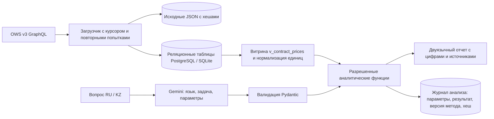

# Архитектура и границы первой версии

OWS → локальное хранилище → аналитика Python/SQL. Gemini преобразует вопросы RU/KZ в проверяемые параметры; модель не вычисляет суммы и цены.

## Хранение

| Таблица | Назначение |
|---|---|
| raw_objects | Версии исходных объектов: entity + source_id + SHA-256; исходные строки сохранены |
| first_seen | Момент первого наблюдения объекта (entity, source_id), записан один раз и не перезаписывается последующими дозагрузками того же неизменившегося содержимого — в отличие от `raw_objects.fetched_at` |
| first_seen_epoch | Единственная неизменяемая отметка момента, когда механизм `first_seen` был развёрнут на конкретной базе; нужна, чтобы не доверять `first_seen` для записей, попавших в базу раньше этого момента (см. `docs/risks.md`) |
| plans, deliveries | План, ЕНС ТРУ, единица, количество, описания, места поставки КАТО |
| announcements | Объявление, организатор, публикация, статус |
| lots, lot_plans | Лоты и связь со всеми доступными пунктами плана |
| contracts, contract_items | Версии договоров, связи root/parent, цена и количество каждой позиции |
| organizations | Заказчики и поставщики: ID, БИН, названия RU/KZ |
| reference_values | ЕНС ТРУ, единицы, КАТО, виды предмета и статусы, встреченные при загрузке |
| sync_jobs | Курсор, число принятых строк и завершенность каждой фильтрованной выборки |
| sync_runs | Итог цикла загрузки: running / complete / partial / failed |
| analysis_runs | Сохраненный результат и параметры анализа для последующей проверки |

SQLAlchemy создает таблицы и индексы. `docs/schema.sql` содержит PostgreSQL DDL, `app/views.sql` — аналитическую витрину. Изменения схемы после первой поставки требуют миграций; автоматический `create_all` не обновляет существующие столбцы.

У БИН строковый тип, чтобы сохранять ведущие нули. Денежные величины в хранилище — NUMERIC(24,6). Нормализованные названия очищаются от HTML, лишних пробелов и различий Unicode. Неизвестные упаковки не переводятся в штуки без сведений о составе.

## Загрузка

Корневые GraphQL-поля: `Plans`, `Contract`, `Lots`; объявления, организации и справочники берутся из связанных объектов. Схема проверялась через introspection и реальные запросы. `ContractUnits.Plans` иногда равен null — загрузчик дополнительно запрашивает корневой `Plans` по ID. Если объект по-прежнему недоступен, связь остается незаполненной и позиция исключается из ценовой аналитики.

Страница нормализуется и записывается вместе с курсором в одной транзакции. Повторный запуск продолжает незавершенные выборки. Удаленные и измененные дочерние записи обновляются; снимки исходных JSON сохраняются. Пустой ответ принимается только с согласованными метаданными завершения. HTTP 429 и временные сетевые/серверные ошибки повторяются с ограничением попыток; ошибки авторизации не повторяются бесконечно.

Инкрементальный режим использует `indexDate`, окно перекрытия 24 часа и watermark начала последнего успешного цикла для того же набора БИН/лет. Каждый цикл worker (`app.cli.run_worker`) выполняет подряд `sync(mode='backfill')` (обычно без эффекта, если backfill уже завершён — курсоры возобновляются, а не стартуют заново) и `sync(mode='incremental')`. Интервал между циклами (`SYNC_INTERVAL_HOURS`, по умолчанию 6 часов) отсчитывается **от начала предыдущего цикла, а не от его завершения** — это намеренно, чтобы долгий цикл не накапливал дополнительный интервал сверху (см. комментарий в `app/cli.py::run_worker`); при ошибке цикл повторяется через 5 минут. Запуск и возраст загрузки доступны в `/api/status` и в отчете. Это механизм, рассчитанный на SLA 24 часа, но фактическое соблюдение SLA от момента публикации конкретной записи на портале (не от момента нашей загрузки) не подтверждено прямым измерением — см. `announcement_publication_lag` в `app.quality.quality_report` и `docs/risks.md`. Физически исчезнувшие объекты без признака удаления в потоке изменений требуют отдельной периодической сверки.

Дополнительные ведомства загружаются командой `peers --enstru ...`: используется `contractUnitsFilter.refEnstruCode`, проверенный на живом API. Без такой загрузки рынок сравнения ограничен уже сохраненными организациями.

## Агент

LLM выбирает только параметры типизированного запроса. Разрешенные функции: поиск, сравнение, сводная аналитика, отклонения цены, Fair Price, аномалии количества. Генерация произвольного SQL отсутствует. Все расчеты выполняет Python/SQL. Ответ собирается из шаблонов RU/KZ, что сохраняет числа и идентификаторы и устраняет отдельный этап перевода цифр.

## Развертывание

Для локальной проверки используется SQLite с WAL. `Dockerfile` и `compose.yaml` предоставляют PostgreSQL 16, отдельные API и worker с постоянным томом для БД. API публикуется на localhost; публичный доступ, аутентификация пользователей, роли, TLS и резервное копирование предоставляются инфраструктурой организации. Токен OWS монтируется как Compose secret только в worker и читается после сборки образа. Пароль PostgreSQL также монтируется как secret, а не встраивается в образ. Worker и API подключаются к одной БД; состояние загрузки и отчеты сохраняются в ней. UI не получает токен. Установка не требует внешних шрифтов или CDN.

Манифесты `k8s/` разворачивают тот же образ как Deployment'ы PostgreSQL/api/worker через тот же механизм чтения secrets из `/run/secrets` — без изменений кода приложения между Compose и Kubernetes. Проверено сборкой (`kubectl kustomize`); применение на живом кластере не выполнялось (см. `docs/risks.md`).

При росте данных свыше 200 000 строк текущая аналитика останавливается с явной ошибкой вместо усечения выборки. Следующий этап масштабирования — SQL-агрегации по фильтрам и материализованные витрины. Это эксплуатационное ограничение MVP, а не заявленная поддержка всего национального реестра в памяти.

Перед инкрементальной загрузкой выполняется полный обход глобального окна публикаций TrdBuy: API не поддерживает customerBin-фильтр, поэтому заказчик/организатор отбираются локально. Обход проверяет totalCount, уникальность ID и продвижение курсора; незавершённый обход не выдаётся за полное покрытие.

Текущий провайдер: Gemini. Задайте GOOGLE_API_KEY и GEMINI_MODEL. Автоматическая подмена модели шаблонами отключена. Для контейнерного API ключ читается из secrets/google_api_key; Kubernetes Secret содержит google_api_key. Данные и расчёты остаются в хранилище приложения; Google получает вопрос и параметры для маршрутизации. Требуется исходящий доступ к API Google.
